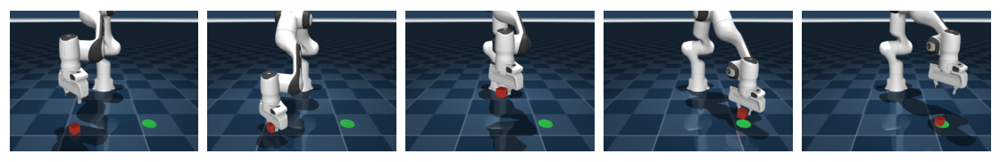
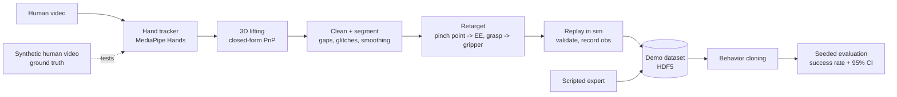

# demo2policy

[](https://github.com/akshar27/demo2policy/actions)

**Learning robot manipulation from human video.** A research scaffold that turns a monocular video of a person picking
and placing an object into robot demonstrations, trains an imitation policy on them, and measures it in a MuJoCo
simulation (Franka Panda). Every stage is a swappable module, every stage is measured, and the whole loop runs on a laptop.



## What it does



## Results (all simulated; same seeded evaluation episodes, 95% CIs from `d2p eval`)

Policies are evaluated on randomised cube positions/orientations; success = cube released in the target zone.

| policy / training data | success |
|---|---|
| open-loop replay of one demo | 4% (2/50) |
| BC on 10 expert demos | 22% |
| BC on **10 synthetic human videos x 10 scenes** (video-derived) | **70%** |
| BC on 100 expert demos | 94% |

(BC = MLP with 0.05 observation-noise augmentation, mean of 3 training seeds x 100 episodes. Full tables in `docs/results/`.)

Findings that shaped the code:
- **Train-time observation noise is the big lever for BC:** 45% -> 93% on 100 expert demos (`docs/results/bc_sweep.md`).
- **Depth is the weak axis of monocular lifting.** With 2 px / 3 mm tracker noise at 0.6 m: ~4 mm lateral but ~6 mm depth error,
  and a 5-10% error in the tracker's metric scale becomes **27-57 mm** of depth error (`docs/results/lifting_error.md`).
  Anchoring the path to the cube/target positions absorbs most of that: replays still succeed 87-93% with +-15% scale error.
- **Round trip through synthetic video** (`docs/results/roundtrip.md`): 30/30 replay successes with a clean tracker, 27/30
  with typical noise (2 tracks rejected for an unbridgeable dropout), 23/30 at 4 px noise, and a reprojection-error gate
  rejects 8 px noise outright instead of producing bad demos.
- **One video -> many demos** (retargeting the same hand motion to many cube positions) is what makes a handful of videos
  enough to train on; 1 video alone gives 40%, 10 videos 70%.

## What is verified and what is not

Verified (tests + experiments in this repo): simulator and expert (200/200 on fresh seeds), demo format, replay/BC/eval
harness, lifting geometry against exact ground truth, cleaning/retargeting through synthetic video with injected noise,
dropouts, glitches and scale error, the video->demo CLI with a stub tracker, and the MediaPipe adapter loading and
rejecting an empty frame.

**Not verified yet: real footage.** The "human videos" above are synthetic (the expert's motion filmed by a virtual
camera). Two assumptions are untested on real video: MediaPipe's world-landmark axis convention and the assumed camera
intrinsics (a horizontal FOV you pass in). The camera must be fixed with a **known downward pitch** (`--cam-pitch`) because
alignment rotates about the vertical axis. The first real recordings are milestone 6b; expect the video-derived numbers to
be worse than the synthetic ones.

## Optional: Depth Anything V2

`d2p video-to-demo ... --depth` fuses Depth Anything V2 (Small) into the hand depth. On simulator renders with exact depth
it tracks inverse depth at Spearman 0.98 and reaches ~1.5% depth error after calibrating on 5 pixels
(`docs/results/depth_check.md`) - but that scene is a robot arm, not a hand on real footage, and the model is calibrated against
the PnP depth, so it cuts per-frame noise without fixing a wrong hand-size scale. It is off by default until real video says it helps.

## Quickstart

```bash
python3.11 -m venv .venv && .venv/bin/pip install -e ".[dev,vision,learn,depth]"
.venv/bin/python -m pytest -q                       # 40 tests
.venv/bin/d2p gen-expert --n 100 --out data/expert.h5
.venv/bin/d2p train-bc --n-demos 100 --obs-noise 0.05 --out runs/bc
.venv/bin/d2p eval bc:runs/bc/model.pt --episodes 100
# from a real video (first run downloads the hand-landmarker model):
.venv/bin/d2p video-to-demo my_pick_and_place.mp4 --cam-pitch 35 --hfov 65 --scenes 20 --out data/video_demos.h5
.venv/bin/d2p train-bc --demos data/video_demos.h5 --obs-noise 0.05 --out runs/bc_video
```
`video-to-demo` writes a QA report (`runs/video_qa/`: tracking curves, reprojection error, retargeted paths, rejection reason).
Reproduce the experiments with `scripts/bc_sweep.py`, `scripts/lifting_error.py`, `scripts/roundtrip_eval.py`, `scripts/video_to_bc.py`.

## Design decisions & tradeoffs

- **Pinch point, not wrist, is the end-effector.** It is where the object is held and maps to a parallel gripper's tool point.
- **Closed-form lifting.** The tracker's metric hand landmarks make perspective constraints linear in the translation, so
  depth comes from a 42x3 least-squares problem instead of an iterative PnP; the reprojection residual doubles as a per-frame
  confidence signal.
- **Anchor alignment instead of camera calibration.** The camera's pose relative to the robot is rarely known; a similarity
  transform pins the human grasp point to the cube and the release point to the target. It also gives the data-multiplication trick.
- **Reject, don't repair.** Bad tracks are rejected with a reason (no hand, long dropout, low valid ratio, no visible grasp,
  IK-infeasible, bad scale) and every retargeted demo is replayed in the sim; failures are counted, not hidden.
- **Absolute-target action space** (EE position + gripper + yaw, IK in the loop, rate-limited): any demo source and any policy
  share one physically bounded interface.
- **State-based BC first.** Isolates the video pipeline from vision learning; images come later.

## Out of scope (for now)

Real-robot deployment; multi-finger hands; language conditioning; moving cameras / two hands; image-based or diffusion
policies (natural next steps); object tracking from video (the sim supplies cube pose); any claim that video-derived
policies match teleoperated-data policies.

## Layout

`demo2policy/sim` MuJoCo env + IK + expert · `perception` hand model + trackers · `geometry` camera + lifting ·
`retarget` clean / segment / retarget · `synth` ground-truth human generator · `data` demo format · `policies` replay + BC ·
`eval` rollouts + statistics · `pipeline.py`, `cli.py`, `qa.py` · design: `docs/system-design.md`, plan: `docs/milestones.md`.
The Franka Panda model under `sim/assets/panda` is from MuJoCo Menagerie (Apache-2.0), with a grasp-centre site added.
