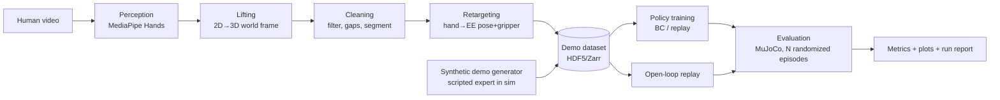

# demo2policy — System Design

## 1. Problem
Teaching a robot a manipulation skill normally needs teleoperated demonstrations: a robot, a teleop rig, and an operator.
That is slow and expensive. Humans, by contrast, produce unlimited manipulation video for free. The open problem is
turning **ordinary monocular human video into robot-usable demonstration data** and showing that a policy trained on it
actually succeeds. Industry and labs (Figure, Google DeepMind, Toyota Research, Stanford's UMI/DexMV lines) pursue this
because it removes the data bottleneck. The hard parts are well known: noisy 3D from one camera, the human-hand ↔
robot-gripper embodiment gap, and measuring whether the result works, not just looks plausible.

demo2policy is a **research scaffold** for that pipeline: each stage is a swappable module with a typed interface, every
stage is measured, and the whole loop runs end to end on a laptop in simulation. It is built to be changed and
experimented on, not a one-shot demo.

## 2. Users & use cases
Primary user: the author, doing experiments after the base is built (new videos, new parameters, new learners). Secondary:
a reviewer reading the repo as evidence of robotics-ML systems skill.

1. **Ingest** a human video of a task → get a cleaned 3D hand/object trajectory with quality diagnostics.
2. **Retarget** the trajectory to a simulated robot, replay it, and see whether open-loop replay already succeeds.
3. **Train** a policy on a set of retargeted demos and **evaluate** success rate over randomized episodes.
4. **Experiment**: change a parameter (smoothing, retargeting scale, policy type, number of demos, observation type) and
   compare runs on the same evaluation harness.

## 3. Requirements
### Functional
- Extract per-frame hand pose (21 landmarks, wrist pose, grip aperture) from a video file; handle missing/low-confidence frames.
- Estimate hand 3D position in a consistent world frame from monocular video, with an explicit, documented depth assumption.
- Retarget to a robot end-effector pose + gripper command per timestep.
- Store demonstrations in one on-disk format shared by every downstream stage.
- Simulated tabletop scene with randomizable object pose; success detector for the task.
- Train and evaluate imitation policies; report success rate with confidence intervals.
- Every run is reproducible from a config file + seed and writes metrics and plots to a run directory.

### Non-functional
- Runs on a MacBook (CPU/MPS); one demo trains in minutes, not hours.
- Deterministic given seed; no network needed after dependency/model download.
- Each module testable on synthetic data without real video.
- Honest reporting: failures and the sim-vs-real-video gap are measured and shown, not hidden.

## 4. Scope
**In scope for v1**
- Task 1: **pick-and-place a cube to a target zone** on a tabletop (single arm, parallel-jaw gripper).
- Monocular RGB video of one hand, one camera, mostly static.
- Behavior cloning (MLP) and a replay baseline; evaluation harness; ablations.
- State-based policy first (object pose known in sim), image-based as a later milestone.

**Explicitly out of scope**
- Real-robot deployment; dexterous multi-finger robot hands; multi-task language conditioning.
- Learning from videos with moving cameras or two hands; full-scene 3D reconstruction.
- Claiming the video-derived policy beats teleop-data policies.

**Possible v2**
- Diffusion Policy / ACT learner; push and drawer tasks; object tracking from video instead of known sim object pose;
  sim-to-video domain randomization; a second camera for metric depth.

## 5. Architecture

Components (Python package `demo2policy/`):
- `perception/` — video decode, hand landmark detector behind a `HandTracker` interface (MediaPipe adapter now).
- `geometry/` — camera intrinsics (calibrated or assumed FOV), lifting, world-frame alignment, Kalman/One-Euro smoothing.
- `retarget/` — hand→end-effector mapping, grasp-aperture→gripper mapping, workspace scaling, IK feasibility check.
- `data/` — `Demo` / `DemoSet` types, writer/reader, dataset statistics and visual QA (overlay and trajectory plots).
- `sim/` — MuJoCo scene (Franka Panda from MuJoCo Menagerie + cube + target), IK controller, success detector, randomization.
- `policies/` — `Policy` interface; replay baseline, BC-MLP; (v2) diffusion.
- `eval/` — rollout runner, success-rate statistics, ablation sweeps, report generation.
- `cli.py` — `d2p track|retarget|replay|train|eval|report` driven by YAML configs.

Main data flow: video → `HandTrack` (per-frame 3D) → `Trajectory` (cleaned, segmented into reach/grasp/transport/release) →
`Demo` (robot-frame EE poses + gripper + sim initial state) → policy → rollout → success.
Failure path: low-confidence tracking → frames flagged and interpolated up to a gap limit, else the demo is **rejected with a
reason** (not silently used); IK-infeasible retargets are reported per-demo; replay failures are logged with the failing phase.

## 6. Data model
`Demo` (one episode), stored as HDF5 groups under a `DemoSet`:
| field | shape / type | notes |
|---|---|---|
| `t` | (T,) float32 s | timestamps at resample rate (default 20 Hz) |
| `ee_pos` | (T,3) float32 m | end-effector position, robot base frame |
| `ee_quat` | (T,4) float32 | orientation, wxyz |
| `gripper` | (T,) float32 | 0 closed … 1 open |
| `obs_state` | (T,D) float32 | proprio + object pose (sim-state obs) |
| `obs_image` | (T,H,W,3) uint8, optional | rendered sim frames for image policies |
| `source` | attrs | origin: `video:<file>` or `scripted`; tracker conf stats; cleaning params; seed |
| `quality` | attrs | valid-frame ratio, jitter, max jump, IK failures, accepted/rejected + reason |
`DemoSet` manifest: JSON with schema version, config hash, list of demos, split (train/val/eval-initial-states).
Run directory: `runs/<name>-<hash>/{config.yaml, metrics.json, episodes.parquet, plots/, report.md}`.

## 7. API surface
Library + CLI (no network service in v1).
- `d2p track VIDEO --out tracks/x.npz` — emits HandTrack; exit non-zero with reason if unusable.
- `d2p retarget tracks/x.npz --robot panda --out demos/` — Demo + quality report.
- `d2p replay demos/x.h5 --render` — open-loop replay in sim, prints success + failing phase.
- `d2p train --config cfgs/bc.yaml` — trains on a DemoSet, saves checkpoint.
- `d2p eval --policy ckpt --episodes 100 --seed 0` — success rate ± Wilson 95% CI.
- `d2p report runs/a runs/b` — comparison table across runs.
Errors: unreadable video, no hand detected, below valid-frame threshold, IK infeasible, schema-version mismatch.

## 8. Key algorithms / mechanisms
1. **Monocular lifting.** MediaPipe gives 2D landmarks plus a relative per-landmark depth. Metric depth is estimated from
   apparent hand size (known approximate hand length → depth via pinhole model), then scale-calibrated per video by a
   known reference (table height / start pose). The assumption and its error are documented and tested on synthetic
   projections where ground truth is known.
2. **Cleaning & segmentation.** One-Euro filter on position, quaternion slerp smoothing, gap interpolation with a max-gap
   limit, outlier rejection by max velocity; segment into reach/grasp/transport/release using gripper aperture + speed
   thresholds (hysteresis, same style as a rep state machine).
3. **Retargeting.** Wrist pose → EE pose through a fixed hand-to-gripper transform; pinch aperture (thumb–index distance)
   → gripper width; trajectory affinely scaled/offset into the robot workspace; **IK feasibility check** along the path,
   with optional projection of infeasible points. Grasp orientation can be constrained to top-down.
4. **Policy learning.** BC-MLP on `(obs_state) → (Δee_pos, gripper)` with action chunking option; replay baseline
   re-executes the retargeted trajectory open-loop. Evaluation compares them on **randomized object positions**, where
   open-loop replay should degrade and a learned closed-loop policy should help — that comparison is the main experiment.
5. **Evaluation statistics.** Success rate with Wilson interval over N seeded episodes; paired comparison between runs on
   identical initial states.

## 9. Scaling & failure modes
- Compute: tracking ~real time on CPU; BC training minutes; sim rollouts fast (headless MuJoCo). Rendering for image
  policies is the first bottleneck — offline cached rendering, small resolution.
- Perception failures: motion blur, hand occlusion by the object during grasp (exactly when it matters) → gap handling,
  per-demo quality gate, and reporting of rejected-demo rate.
- Embodiment gap: human grasps are not robot-feasible; mitigated by top-down constraint, IK check, and measured via replay
  success before any learning.
- Data scarcity: few real-video demos → hybrid: scripted-expert demos in sim to validate the learner, real-video demos
  to test the whole chain; report them separately.
- Reproducibility: seeds, config hashes, pinned deps, deterministic sim stepping.

## 10. Tech / language options
- **Python 3.11** — the ML/robotics ecosystem (MuJoCo, PyTorch, MediaPipe, NumPy) lives here.
- Sim: **MuJoCo** (+ `mujoco_menagerie` Panda); alternative ManiSkill/robosuite (heavier, more tasks, more setup).
- Learning: **PyTorch** (MPS/CPU). Storage: HDF5 (h5py) or Zarr. Config: YAML + pydantic. CLI: typer. Tests: pytest.
- Tracking: **MediaPipe Hands**; alternatives HaMeR/WiLoR (better 3D, heavy GPU) as later swap behind `HandTracker`.
(Language recommendation recorded at stage 4.)

## 11. What this demonstrates on a résumé
Robotics-ML pipeline design (perception → retargeting → imitation learning → sim evaluation); coordinate-frame/geometry
rigor with ground-truth tests; honest experimental methodology (seeded evals, CIs, ablations); a reproducible research
codebase with typed interfaces and CI. Complements policyserve (robot policy serving) and repvision-ai (pose
estimation) — together they span perception, learning and deployment for robotics roles.

## 12. Open decisions (for review)
1. Task: pick-and-place cube (proposed) — OK, or push / other?
2. Robot: Franka Panda from MuJoCo Menagerie (proposed) vs reusing policyserve's simple arm.
3. v1 policy observation: object pose state first, images later (proposed).
4. Do you already have a video of the task, or should the first real video be recorded after the synthetic pipeline works?
